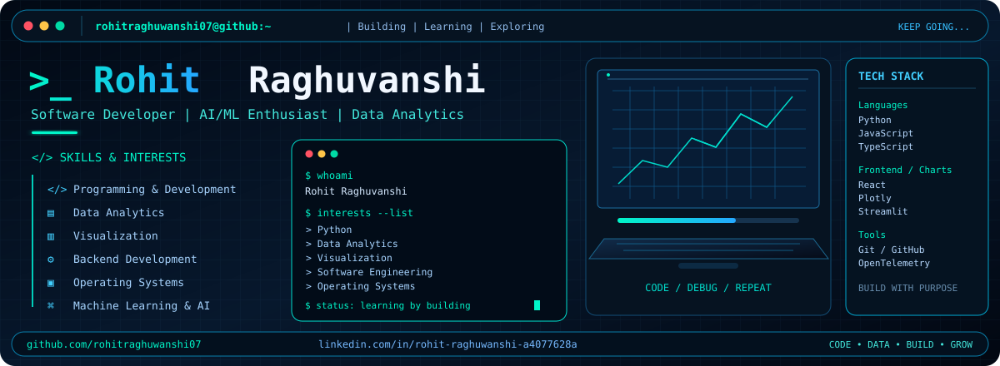

  

<h1 align="center">Rohit Raghuvanshi</h1>

  <b>Software Developer | AI/ML Enthusiast | Data Analytics</b>

  <a href="https://github.com/rohitraghuwanshi07">GitHub</a>
  &nbsp; • &nbsp;
  <a href="https://www.linkedin.com/in/rohit-raghuwanshi-a4077628a/">LinkedIn</a>

---

## `whoami`

I'm interested in building practical software projects across development, data analytics, machine learning, and systems engineering. I enjoy learning by building, understanding how applications work, and solving technical problems through experimentation.

## `./toolkit`

**Languages:** Python, JavaScript, TypeScript

**Frontend & Visualization:** React, Chart.js, Plotly, Streamlit

**Engineering Tools:** Git, GitHub, OpenTelemetry

**Interests:** AI/ML, backend development, operating systems, data analytics, debugging

## `./currently-learning`

- Operating system concepts
- Backend and real-time application design
- Applied machine learning
- Software observability and debugging

## `./connect`

- GitHub: [@rohitraghuwanshi07](https://github.com/rohitraghuwanshi07)
- LinkedIn: [Rohit Raghuvanshi](https://www.linkedin.com/in/rohit-raghuwanshi-a4077628a/)

  <i>Code • Data • Build • Grow</i>

