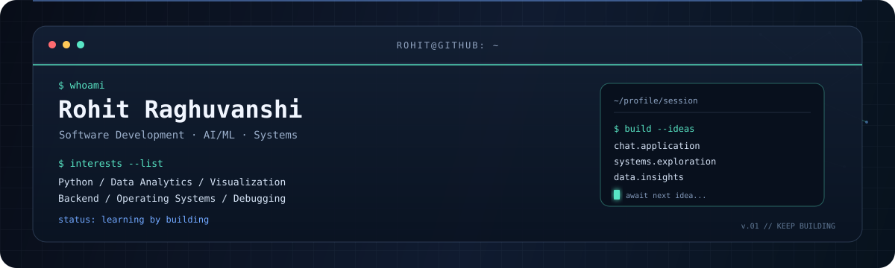

<!-- Animated theme-aware GitHub profile banner -->
<picture>
  <source media="(prefers-color-scheme: dark)" srcset="dark.svg">
  
</picture>

<h1 align="center">Hi, I'm Rohit 👋</h1>

  <b>Software Development · AI/ML · Data Analytics · Backend Developer</b>

  
  

## About Me

I'm interested in building practical software projects that bring together programming, data, machine learning, and systems engineering. I enjoy exploring how applications work, analyzing data, debugging technical problems, and turning ideas into working prototypes.

- 💻 Interested in software development and backend engineering.
- 🤖 Exploring AI/ML and data-driven problem solving.
- 📊 Interested in interactive analytics and data visualization.
- 🖥️ Exploring operating systems and systems-level concepts.
- 🔍 Interested in debugging, observability, and reliable applications.

## Tech Stack & Tools

  
  
  
  
  
  
  
  
  

## Current Learning Interests

- Operating system concepts and low-level systems engineering
- Reliable backend and real-time application design
- Applied machine learning and marketing analytics
- Observability, debugging, and performance improvement

## Connect With Me

- **GitHub:** [@rohitraghuwanshi07](https://github.com/rohitraghuwanshi07)
- **LinkedIn:** [Rohit Raghuvanshi](https://www.linkedin.com/in/rohit-raghuwanshi-a4077628a/)

---

  <i>Learning by building. Improving by debugging. Growing through experimentation.</i>

